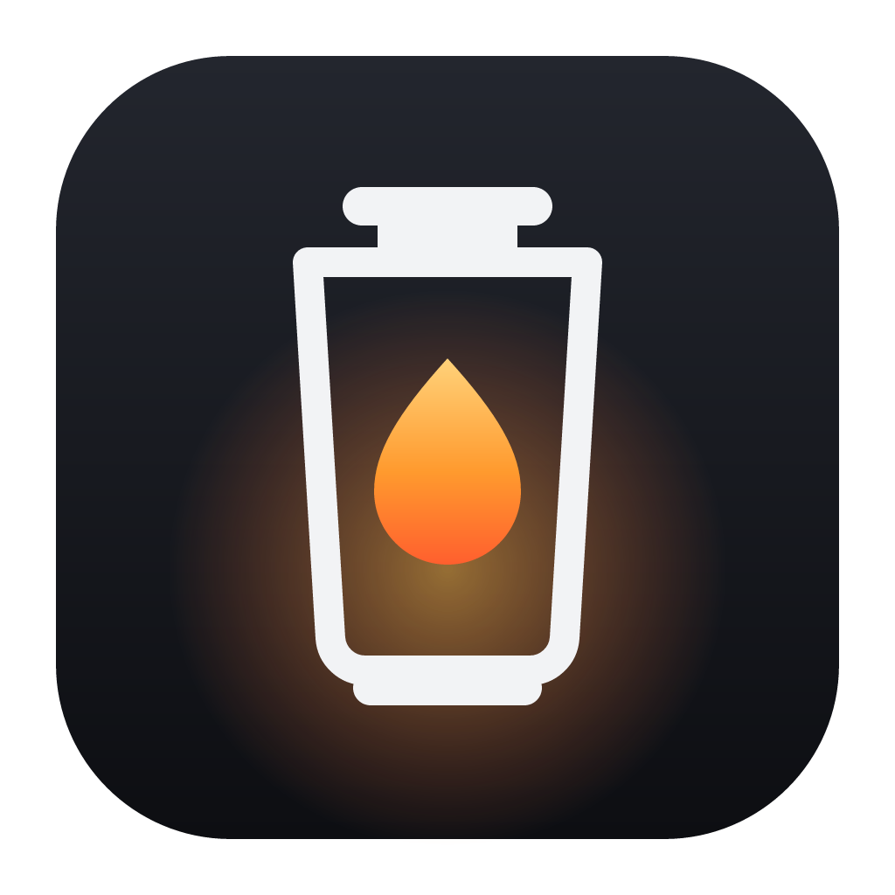

<p align="center">
  
</p>

<h1 align="center">Lantern</h1>

<p align="center"><b>Find anything. Leave no trace.</b><br>
A private web browser with its own search, cited summaries and an AI assistant that uses <i>your</i> key with Claude, ChatGPT, Gemini or Groq.</p>

<p align="center">
  <a href="../../releases/latest">Download</a> ·
  <a href="#features">Features</a> ·
  <a href="#build-it-yourself">Build</a> ·
  <a href="#privacy">Privacy</a>
</p>

---

## Download

Get the latest installer from **[Releases](../../releases/latest)**:

| System | File | Notes |
|---|---|---|
| macOS 13 or later (Apple Silicon and Intel) | `Lantern-x.y.z-universal.pkg` | Right-click → **Open** the first time (the installer isn't notarized yet). |
| Windows 10 or later (64-bit) | `Lantern-Setup-x.y.z.exe` | If SmartScreen appears, click **More info → Run anyway**. |

Your profiles, history, bookmarks and keys are kept when you update.

## Features

**AI assistant (side panel)**
- Click **AI** at the top right of the toolbar, or press <kbd>⇧⌘A</kbd> / <kbd>Ctrl+Shift+A</kbd>.
- Paste an API key from **Claude (Anthropic)**, **ChatGPT (OpenAI)**, **Gemini (Google)** or **Groq**. Lantern recognises which service a key belongs to, checks it with that service, then stores it encrypted.
- Switch services from the arrow next to the AI button. Each service gets its own correctly formatted request, and the answers stream in as they're written.
- Ask about the page you're on, a selection (right-click → *Ask AI*), or anything else. Typing a question in the address bar offers *Ask Claude/ChatGPT/…*.

**Search and summaries**
- Lantern Search: private results re-ranked on your device, with a summary in which every point links to its source.
- A **Mail** link at the top right of Lantern Search and the New Tab page. It opens Gmail, Outlook, Proton Mail, Yahoo, iCloud, Zoho, Fastmail or any web mail address you choose.

**Tabs your way**
- Vertical tabs in a sidebar (⇧⌘E), on the left or right, resizable or collapsed to icons.
- Split view: two tabs side by side (⌥⌘S, Shift+click a tab, or right-click a link).
- Tab groups with names and colours, compact mode, and Ctrl+Tab in most-recently-used order.
- `@tabs`, `@history` and `@bookmarks` search in the address bar.

**!bangs**
- `!w moon`, `moon !yt`, `!gh lantern`: 185 built-in shortcuts, plus your own. They're resolved on your device by the Rust core.

**Everyday browsing**
- History page with search (<kbd>⌘Y</kbd> / <kbd>Ctrl+H</kbd>), and address-bar suggestions that complete addresses as you type.
- Bookmarks: the star in the address bar, a bookmarks bar (<kbd>⇧⌘B</kbd>) and a bookmark manager.
- Private windows (<kbd>⇧⌘N</kbd>): nothing from the window is kept after you close it.
- Reopen closed tabs (<kbd>⇧⌘T</kbd>), and pin, mute or duplicate tabs from the tab menu.
- Side panel with **reading mode**, and **Share** with a link and a QR code.
- Print, save page, a zoom indicator, a downloads page, profiles and Chrome Web Store extensions.

**Privacy and safety**
- Ad blocker: ads and trackers blocked, leftover ad boxes hidden, and optionally cookie banners and annoyances too.
- Shields per site, fingerprint protection (standard or strict), clean links with tracking parameters removed, and secure DNS (DNS over HTTPS).
- HTTPS upgrades, Global Privacy Control, third-party cookies blocked, and incognito windows.
- **Lantern services**: a live log of every request Lantern makes on its own, and switches to turn them off.
- Warnings for scam and malware sites, using threat lists checked on your device.
- Memory saver puts idle tabs to sleep.
- Custom theme colour, adjusted automatically so text stays readable in light and dark mode.

## Privacy

- **No Lantern server.** Searches go to DuckDuckGo's index without cookies, and AI questions go straight from your computer to the service you picked.
- **Keys stay yours.** API keys are encrypted with the system keychain (Keychain on macOS, DPAPI on Windows), stored only in your profile and only ever sent to the service they belong to. Pages never see them, only a masked preview.
- **Page text only when you choose.** When *This page* is on in the AI panel, the page's text is sent with your question. Turn it off to stop that.
- History, bookmarks and recent searches stay on your device. Private windows keep none of them.

## How it's built

```
rust/lantern-core/   Rust core, compiled to WebAssembly
  ai.rs              requests and streamed answers for Claude, OpenAI, Gemini and Groq; key detection; readable errors
  settings.rs        every setting a page can change is validated here before it's saved
  theme.rs           custom colours turned into contrast-checked light and dark palettes
  rank.rs            history and bookmark ranking plus inline completion for the address bar
  bangs.rs           !bangs: 185 built-in shortcuts plus your own, as prefix or suffix
  cleanurl.rs        strips tracking parameters from links
  mail.rs, qr.rs     the Mail link and QR codes for sharing
app/                 Electron app
  src/main.js        windows, tabs, side panel, menus and IPC
  src/ai.js          encrypted key storage and streaming (uses the Rust core)
  src/library.js     history and bookmarks
  src/pages/         Lantern Search, New Tab, Settings, Library and the side panel
  src/ui/            tab strip and toolbar
  test/              end-to-end test that runs in a real window
build/               build scripts (WebAssembly core, universal macOS app, .pkg, Windows installer)
```

The Rust core is pure computation: it never touches the network or the disk. The Electron main process loads `lantern_core.wasm` and calls it with JSON, so the same compiled core runs on macOS and Windows.

## Build it yourself

Requirements: Node.js 22+, Rust (stable), and for the WebAssembly target `rustup target add wasm32-unknown-unknown`.

```bash
# 1. Rust core → WebAssembly (also runs the Rust tests)
./build/build-core.sh

# 2. App
cd app
npm install
npm start                       # run Lantern from source

# 3. Installers
npx electron-builder --win nsis --x64            # Windows: dist/Lantern-Setup-x.y.z.exe
npx electron-builder --mac dir --universal       # macOS app: dist/mac-universal/Lantern.app
codesign --force --deep -s - dist/mac-universal/Lantern.app   # ad-hoc sign (macOS)
```

On macOS you can then make the installer with `pkgbuild`, or use `build/make-pkg.py`, which builds the same .pkg on Linux. See [build/README.md](build/README.md) for building everything on Linux, including the Windows installer with Wine.

### Tests

```bash
cd rust/lantern-core && cargo test            # Rust core

cd app                                         # whole app in a real window, with a mock AI service
LANTERN_TEST_SHOT=/tmp/shots LANTERN_NO_EXT=1 LANTERN_AI_MOCK=1 \
LANTERN_AI_MOCK_LOG=/tmp/mock.log LANTERN_TEST_SCRIPT=test/e2e.js npx electron .
```

The end-to-end test saves keys through the real panel, chats with all four services (mocked), and checks history, bookmarks, the address bar, reading mode, sharing, tabs, settings and private windows. It writes screenshots to `/tmp/shots`.

## License

[GPL-3.0](LICENSE)
